<p align="center">
  
</p>

<p align="center">
  
  
  
  
  
</p>

**Sufra ()** is an Arabic-first nutrition companion, built with Flutter and Firebase. It helps people plan meals, log what they eat in the ways that feel natural (search, voice, barcode and photos), track water and weight, follow a calorie plan, and chat with a built-in health coach. The interface is right-to-left first and also ships in English, with light and dark themes.

<p align="center">
  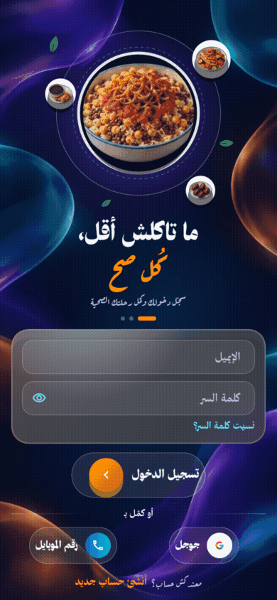
</p>

## A tour of Sufra | 

Every image below is the real app, rendered from this repository's own test suite. No mockups.

<table>
  <tr>
    <td>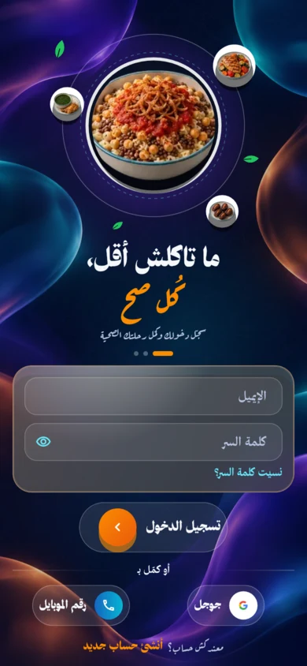<br/><sub>Sign in: email, Google or phone</sub></td>
    <td>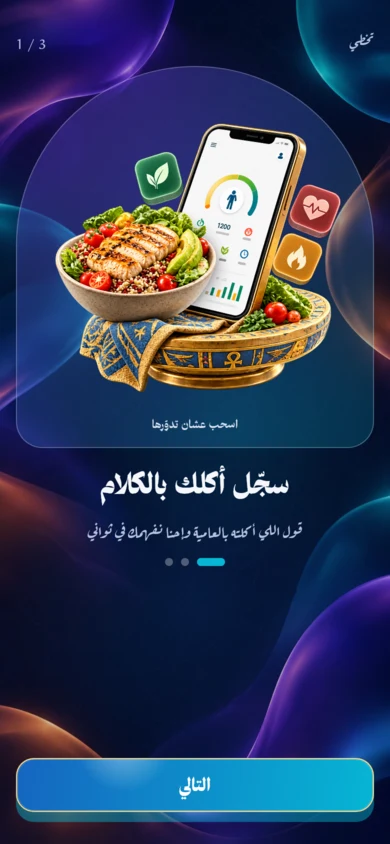<br/><sub>Log a meal by saying it</sub></td>
    <td>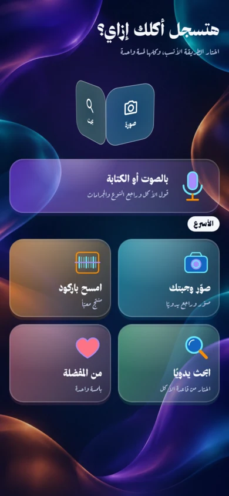<br/><sub>Voice, barcode, photo, favorites or search</sub></td>
  </tr>
  <tr>
    <td>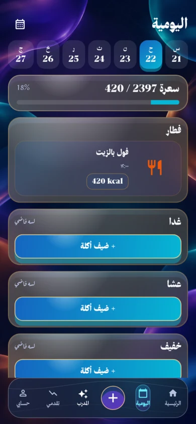<br/><sub>The daily diary at a glance</sub></td>
    <td>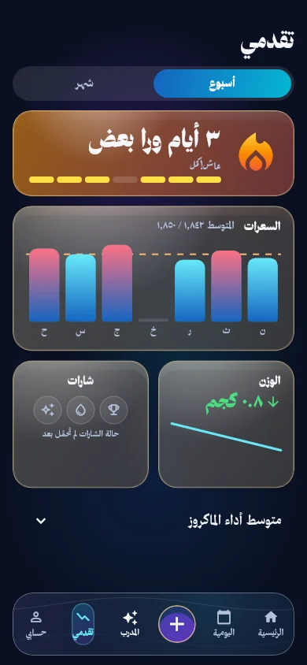<br/><sub>Streaks and weekly statistics</sub></td>
    <td>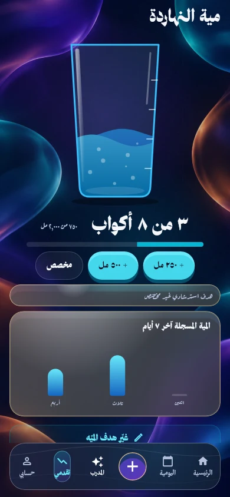<br/><sub>Water, one tap at a time</sub></td>
  </tr>
  <tr>
    <td>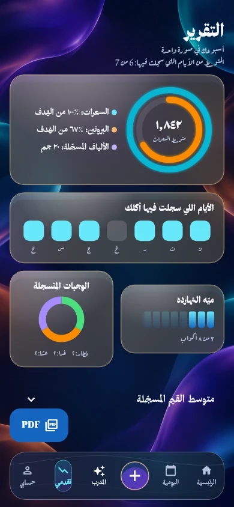<br/><sub>Reports with PDF export</sub></td>
    <td>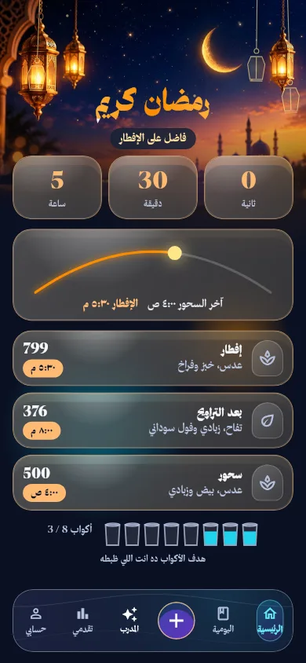<br/><sub>Ramadan mode, suhoor to iftar</sub></td>
    <td>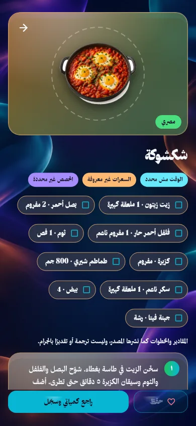<br/><sub>Real dishes, real numbers</sub></td>
  </tr>
  <tr>
    <td>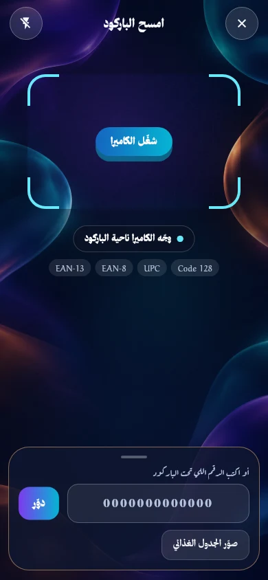<br/><sub>Point at any barcode</sub></td>
    <td>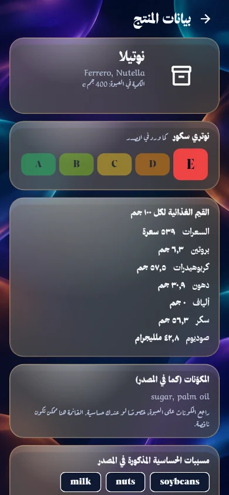<br/><sub>Nutri-Score, ingredients, allergens</sub></td>
    <td>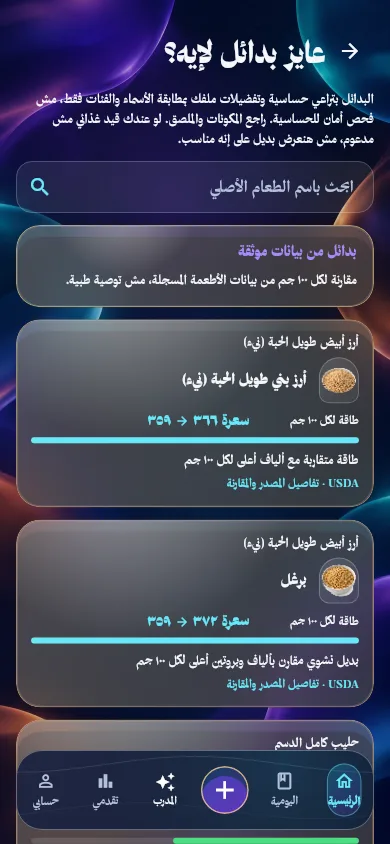<br/><sub>Healthier swaps, side by side</sub></td>
  </tr>
  <tr>
    <td>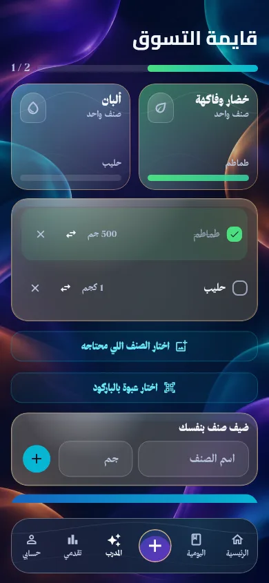<br/><sub>Shopping list, dark</sub></td>
    <td>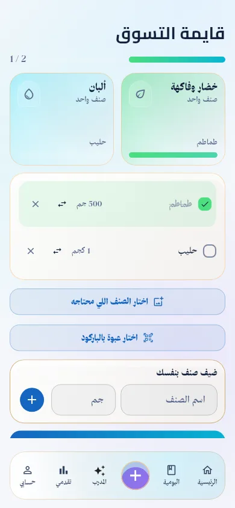<br/><sub>Shopping list, light</sub></td>
    <td></td>
  </tr>
</table>

## Features | 

- **Log food your way:** search the catalog, speak it, scan a barcode, or photograph the plate. The photo flow recognizes what's on the plate, then matches it to sourced food records before anything is saved.
- **A plan that fits:** calorie and macro targets from the health profile, a weekly meal planner, and a shopping list built from the plan.
- **Ramadan mode:** suhoor and iftar planning, fasting-day tracking, and a design made for the month.
- **Progress that motivates:** weight and water tracking, streaks, achievements, and reports that export to PDF in Arabic or English.
- **A coach in the app:** chat, a food calculator and recipe help, running on server-side AI so no keys ever ship in the app.
- **Made for Arabic:** right-to-left layouts, Egyptian food names, Arabic numerals where they belong, and full English support too.
- **Careful engineering:** light and dark themes, phone to tablet to desktop layouts, reduced-motion support, offline-first storage, and a suite of unit, widget, golden and responsive tests.

## How photo analysis works | 

1. **On the phone:** the photo is rebuilt locally from clean pixels. Orientation is fixed, EXIF and location data are removed, and the image is resized and compressed before it goes anywhere.
2. **On the wire:** one HTTPS request carries the photo together with the user's Firebase ID token. Nothing else.
3. **On the server:** a Cloudflare Worker verifies the token, applies per-user limits, and asks open AI models to name the dishes and estimate portions.
4. **Back in the app:** each detected item is matched to a sourced food record for real nutrition values, and the user reviews everything before saving.

## Architecture | 

<p align="center">
  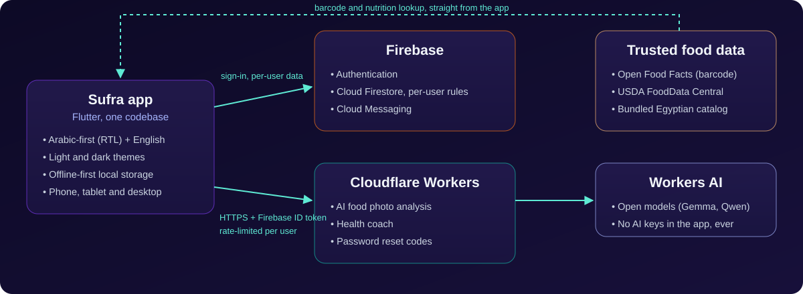
</p>

- **Client:** Flutter, feature-first folders (`domain / data / presentation`), `Cubit` state management, `go_router` with an auth-aware redirect, ARB localization (Arabic and English).
- **Data:** Firebase Auth, Cloud Firestore with per-user security rules, Firebase Messaging. Local, offline-first storage for reminders, caches and the progress ledger.
- **AI features:** food photo analysis and the coach run behind small Cloudflare Workers, so model access stays on the server. Every request carries the user's Firebase ID token and is rate limited per user, which keeps the free tier fair for everyone.
- **Security:** the app stores no credentials, speaks HTTPS only, and secrets live as Worker secrets and are never committed.

```
lib/           app entry, core, data, features, l10n, services
assets/        images, fonts, bundled food and recipe data
backend/       Cloudflare Workers (reset-code, health-coach, food-vision, progression)
design/        original HTML design reference
docs/          architecture notes, credits, signing note, UI fixes, original NutriVision plan
test/          unit, widget, golden and responsive tests
firestore.rules, storage.rules, firestore.indexes.json
```

## The pillars | 

| Pillar | What it means |
| --- | --- |
| **Arabic first** | Designed in Arabic from day one, not translated as an afterthought. |
| **AI on the server** | Models run behind our Workers. The app never holds an AI key. |
| **Egyptian food, real data** | A bundled local catalog plus Open Food Facts and USDA sources. |
| **Always works** | Offline-first: diary, plans and progress are there with or without a connection. |
| **Secure by design** | Per-user Firestore rules, verified tokens, stripped photo metadata. |
| **Engineering quality** | Typed, tested and analyzer-clean, with golden tests guarding every screen. |

## Built entirely on free and open tools | 

| Layer | Tool | Why |
| --- | --- | --- |
| App framework | **Flutter** | One beautiful codebase for Android, iOS, web and desktop. |
| Language ecosystem | **Dart packages** | Open-source building blocks, from `Cubit` to `go_router`. |
| Backend | **Firebase (Spark)** | Auth, Firestore and Messaging on the free plan. |
| Server compute | **Cloudflare Workers** | Serverless code running close to the user, free tier. |
| AI models | **Workers AI: Gemma and Qwen** | Open models for the coach and food vision, called only from the server. |
| Barcode data | **Open Food Facts** | The free, open database of world food products. |
| Nutrition data | **USDA FoodData Central** | Free, authoritative nutrient data. |
| Collaboration | **GitHub** | Code, reviews and releases. |

## The team | 

| Sections | Member |
| --- | --- |
| 1 - 5 | Mohamed Osama |
| 6 - 10 | Abdelrahman |
| 11 - 15 | Ahmed Abdelnasser |
| 16 - 20 | George Karam |
| 21 - 29 | **Mostafa Ghonime** (Team Leader) |
| 30 - 31 | Mohamed Ghazy |

## Getting started

Requirements: Flutter 3.35.7 (Dart 3.9.2).

```sh
flutter pub get
flutter analyze
flutter test test/core        # the full suite is large; run folders separately on small machines
```

### Configure Firebase (required to run)

Firebase settings are not committed.

1. Create a Firebase project and enable Email/Password and Google sign-in.
2. Run `flutterfire configure` to generate `lib/firebase_options.dart`.
3. For Android, place your `google-services.json` in `android/app/` and register your signing SHA-1 (see [docs/ANDROID_SIGNING_NOTE.md](docs/ANDROID_SIGNING_NOTE.md)).
4. Optional: copy `.env.example` to `.env.local` for local overrides.

### Backend Workers (optional)

AI features call the Workers through build-time defines:

```sh
flutter run \
  --dart-define=SUFRA_RESET_URL=<your reset worker> \
  --dart-define=SUFRA_COACH_URL=<your coach worker> \
  --dart-define=SUFRA_FOOD_VISION_URL=<your food vision worker> \
  --dart-define=OFF_CONTACT=<contact email for Open Food Facts>
```

Without these, the AI and barcode features stay off and everything else works. Each Worker folder has a `wrangler.example.*`: copy it to the real config name, fill in your own account and Firebase project ids, and set secrets with `wrangler secret put`. See [backend/README.md](backend/README.md).

The web build also needs the image worker asset: `./scripts/build_image_worker.sh`.

## Documentation

- [Architecture of the progression engine](docs/PROGRESSION_ARCHITECTURE.md)
- [Verification status and UI fixes](docs/UI_FIXES_20261126.md)
- [Android signing note](docs/ANDROID_SIGNING_NOTE.md)
- [Catalog image credits](docs/CATALOG_IMAGE_CREDITS.md)
- [The original NutriVision plan](docs/nutrivision-original/README.md)

## Status

Milestone 1 is complete: the full core experience is implemented, analyzer-clean, and guarded by an automated suite of unit, widget, golden and responsive tests. Physical-device QA is under way; [docs/UI_FIXES_20261126.md](docs/UI_FIXES_20261126.md) tracks what is verified.
