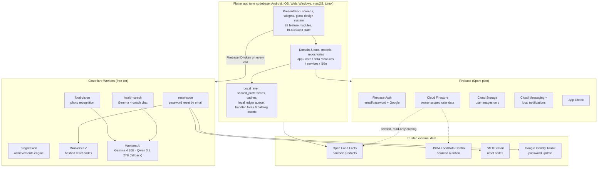
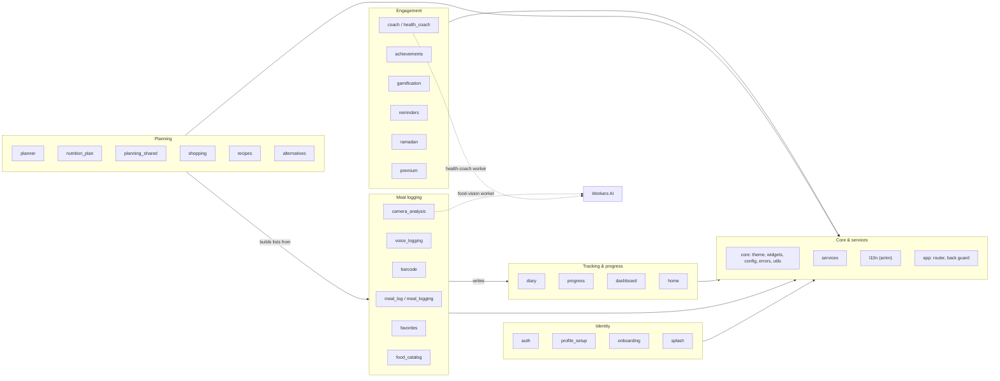
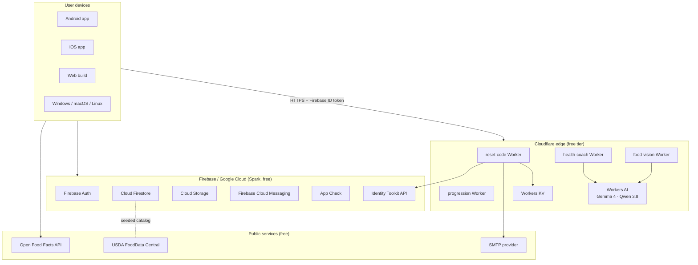

# 07 — System Analysis & Design

**Project:** Sufra (سفرة), Arabic-first nutrition companion
**Group:** HRV | #17 | ONL5_SWD8_G1 | DEPI5
**Track:** Cross-Platform Mobile Development

---

## 1. Problem Statement & Objectives

### Problem
Nutrition apps are built English-first. For an Arabic-speaking, Egyptian user that means translated interfaces that read wrong right-to-left, food databases full of dishes nobody eats at home, and logging flows tedious enough to abandon within a week. On top of that, the apps that do work tend to hide two things: where their numbers come from, and what they cost once you depend on them.

### Objectives
1. An Arabic-first nutrition companion: designed right-to-left from the first pixel, with Egyptian food names and full English support as a second citizen.
2. Logging that fits real life: search, voice, barcode, photo and favorites, so a meal takes seconds.
3. Honest data: sourced nutrition values or a clear empty state, never an invented number.
4. AI that earns trust: server-side recognition and coaching where the model explains and the app computes, consent before any photo leaves the device.
5. Zero-cost operation as a design requirement: every layer on a free tier, with quotas enforced as hard ceilings.
6. One codebase, every screen: Android, iOS, Web, Windows, macOS and Linux from a single Flutter project.

---

## 2. Software Architecture

**Style:** a feature-first modular Flutter client + serverless backend microservices (four Cloudflare Workers), with Firebase as the managed data and auth platform. State management is BLoC/Cubit (`flutter_bloc`), navigation is `go_router`, and data access goes through repository classes over models. The client is offline-first: local caches and queues keep it usable without connectivity.

**Key architectural rules (enforced in code, not just documented):**
- No AI key ever ships in the app. All model calls happen server-side on Workers, each verifying the caller's Firebase ID token.
- The coach never states nutrition numbers in prose. Numbers come from a deterministic catalog tool and are displayed by the app; the model explains them.
- Photo recognition is consent-gated, self-verified by a second model pass, and falls back silently to a second model. An empty result is an honest outcome, not an error.
- Quotas are ceilings: per-user rate limiters stop requests instead of ever billing.

---

## 3. Component Diagram

The real module tree (`lib/features`): achievements, alternatives, auth, barcode, camera_analysis, coach, dashboard, diary, favorites, food_catalog, gamification, health_coach, home, meal_log, meal_logging, nutrition_plan, onboarding, planner, planning_shared, premium, profile_setup, progress, ramadan, recipes, reminders, shared, shopping, splash, voice_logging.

---

## 4. Technology Stack

| Layer | Technology | Version / detail |
|---|---|---|
| Framework | Flutter | 3.35.7 |
| Language | Dart | 3.9.2 |
| State management | flutter_bloc | ^9.1.1 |
| Navigation | go_router | ^16.2.0 |
| Backend platform | Cloudflare Workers | 4 services, ES modules (.mjs) |
| AI inference | Cloudflare Workers AI | Gemma 4 26B A4B (coach, vision default), Qwen 3.8 27B (vision fallback); Moondream evaluated and rejected |
| Auth & user data | Firebase Auth, Cloud Firestore | firebase_core ^5.1.0, firebase_auth ^7.0.1, cloud_firestore ^7.1.0 |
| Files | Firebase Storage | ^14.0.1, owner-scoped images |
| Push & local alerts | Firebase Messaging, flutter_local_notifications | ^17.0.1, ^20.1.0 |
| Abuse protection | Firebase App Check | ^0.5.1 |
| Barcode / camera / voice | mobile_scanner, camera, speech_to_text | ^7.5.0, 0.12.0+1, 7.4.0 |
| PDF reports | pdf | 3.11.3 |
| Local storage | shared_preferences, path_provider | ^2.5.3, ^2.1.5 |
| Localization | intl, flutter_localizations, timezone | Arabic-first + English |
| Food data | Open Food Facts, USDA FoodData Central | free public databases |
| Email | SMTP from the reset-code Worker | bilingual reset emails |
| Typography | Bundled app fonts | SufraDisplay / SufraBody (29LT Azahar), SufraHeading (Zain), SufraCalligraphy (Aref Ruqaa); Cairo / Tajawal / Reem Kufi also bundled |
| Version control | Git + GitHub | NutriVision-Team/NutriVision |

---

## 5. Deployment Diagram

---

## 6. Deployment Strategy

**Hosting environment.** Firebase (Spark free plan) hosts auth, database, storage and messaging. Cloudflare's free tier hosts all backend logic as Workers at the edge, with Workers KV for short-lived reset codes and Workers AI free allocations for inference. Public food data comes from Open Food Facts and USDA, both free.

**Cost model.** Free tier is a hard constraint, not a lucky accident. Per-user rate limiters and daily caps stop requests at the ceiling. There is no billing path to trip.

**Release process (current, honest):**
1. Code lands on `main` of NutriVision-Team/NutriVision through reviewed commits.
2. Quality gates run locally before merge: `flutter analyze` (analyzer-clean requirement) and `flutter test` per folder (the full suite is large).
3. Workers deploy with `wrangler deploy`; secrets are set with `wrangler secret put` and never committed. Real `wrangler` configs are git-ignored; only `wrangler.example.*` templates are in the repo.
4. The web build needs the image worker asset from `./scripts/build_image_worker.sh`.

**CI/CD.** Not configured. The guidelines mark CI/CD "if applicable"; with a six-person student team on free tiers, the manual gates above are the current pipeline. A GitHub Actions workflow running `flutter analyze` and the test suite is the planned next step (see future work in 14 Technical Documentation).

**Configuration.** Firebase settings are not committed. A new environment is created with `flutterfire configure`, `google-services.json` placed per platform, and Worker URLs passed as build-time `--dart-define` values. Without them, AI and barcode features stay off and the rest of the app works.

**Signing.** Release signing for Android currently uses the debug key; production signing is deferred and tracked in `docs/ANDROID_SIGNING_NOTE.md`.

**Scaling considerations.** The serverless backend scales with Cloudflare's edge automatically within free allocations; per-user limiters protect the shared pool. Firestore reads are minimized by denormalized daily totals and local caches. If the user base outgrows free tiers, the first paid step is Cloudflare's paid Workers plan; the architecture needs no change.
