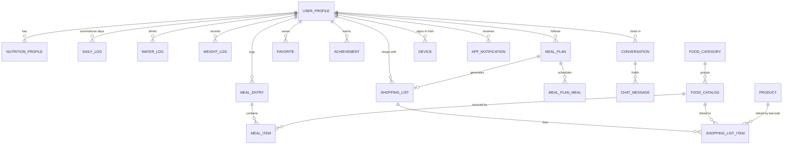

# 08 — Database Design & Data Modeling

**Project:** Sufra (سفرة)
**Group:** HRV | #17 | ONL5_SWD8_G1 | DEPI5
**Track:** Cross-Platform Mobile Development

Sufra uses **Cloud Firestore**, a document database, plus **Firebase Storage** for images and **Cloudflare Workers KV** for short-lived reset codes. The ERD below shows the logical entities and relationships; the physical schema section gives the real Firestore paths and access rules exactly as deployed.

---

## 1. Entity-Relationship Diagram (logical)



**Read-only reference data** (seeded, unwritable by clients): `FOOD_CATALOG`, `PRODUCT`, `RECIPE`, `FOOD_CATEGORY`, `APP_CONFIG`.

---

## 2. Logical Schema

Field types follow the app's model classes in `lib/data/models/`.

### users — UserProfileModel
| Field | Type | Notes |
|---|---|---|
| uid | string | primary key, equals the Firebase Auth UID |
| displayName | string | first + last name, collected at sign-up |
| email, phoneNumber, photoUrl | string / null | |
| preferredLanguage | string | `ar` or `en` |
| timezone | string | IANA name |
| measurementSystem | string | metric default |
| notificationPreferences | map<string, bool> | |
| onboardingCompleted | bool | gates the setup wizard |
| accountStatus | string | |
| policyAcceptance | map / null | privacy & terms consent record |
| createdAt, updatedAt | timestamp | |

### nutrition_profiles — NutritionProfileModel
profileId · gender · dateOfBirth · heightCm · currentWeightKg · targetWeightKg · activityLevel · nutritionGoal · **dailyCalorieTarget, proteinTarget, carbsTarget, fatTarget** · dietaryPreferences[] · allergies[] · healthRestrictions[] · isActive · createdAt · updatedAt

### meal_entries — MealEntryModel
mealId · userId · dateKey (yyyy-MM-dd in the user's timezone) · consumedAt · mealType · **inputMethod** (search / voice / barcode / photo / favorites) · title · imageUrl? · **items: MealItemModel[]** · totalCalories · totalProtein (+carbs, fat, fiber, sugar, sodium)

MealItemModel: foodId · foodName · quantity · unit · weightInGrams · calories · protein? · carbohydrates? · fat? · fiber? · sugar? · sodium? · **dataSource** · confidence?

### daily_logs — DailyLogModel
dateKey (document key) · timezone · totalCalories / totalProtein / totalCarbs / totalFat / totalFiber / totalSugar / totalSodium · calorieTarget / proteinTarget / carbsTarget / fatTarget · waterIntakeMl · mealCount · updatedAt

### water_logs — WaterLogModel
waterId · amountMl · consumedAt · dateKey · createdAt

### weight_logs — WeightLogModel
weightId · weightKg · recordedAt · dateKey · note? · createdAt

### meal_plans — MealPlanModel
planId · title · startDate · endDate · status · dailyCalorieTarget · **meals: MealPlanMealModel[]** · generatedBy · createdAt · updatedAt

MealPlanMealModel: mealId · title · mealType · calories · foods[] · foodPortions: MealPlanFoodPortion[] (foodId, grams) · dateKey?

### shopping_lists — ShoppingListModel + items
ShoppingListModel: listId · title · planId? · status · createdAt · updatedAt
ShoppingListItemModel: itemId · name · quantity · unit · category · isPurchased · linkedFoodId? · productBarcode? · productImageUrl? · productBrand? · productSourceUrl?

### favorites — FavoriteModel
favoriteId · targetId · targetType · title · imageUrl? · createdAt

### conversations + messages — ConversationModel / ChatMessageModel
ConversationModel: conversationId · title · createdAt · updatedAt · lastMessageAt
ChatMessageModel: messageId · role · content · messageType · metadata? · createdAt

### achievements — AchievementModel
achievementId · achievementType · title · description · progress · target · isUnlocked · unlockedAt? · createdAt

### devices — DeviceModel
deviceId · fcmToken · platform · deviceName · language · isActive · lastSeenAt · createdAt · updatedAt

### notifications — AppNotificationModel
notificationId · title · body · type · payload? · isRead · createdAt · readAt?

### food_catalog — FoodCatalogModel (public, read-only)
foodId · name · localizedNames (map) · category? · foodState? · **sourceUrl?** · servingSizes (map) · nutritionPer100g (map) · source? · sourceId? · **verificationStatus?** · createdAt · updatedAt

### products / recipes / food_categories / app_config (public, read-only)
products keyed by barcode (Open Food Facts data: Nutri-Score, ingredients, allergens). recipes gated to published content. app_config holds versioned, read-only configuration (for example the gamification rules).

---

## 3. Physical Schema (Firestore layout, exactly as deployed)

```
users/{uid}                                  owner read/write; create requires the full key set
users/{uid}/nutrition_profiles/{profileId}   owner only
users/{uid}/meal_entries/{mealId}            owner only
users/{uid}/daily_logs/{dateKey}             owner only
users/{uid}/weight_logs/{weightId}           owner only
users/{uid}/water_logs/{waterId}             owner only
users/{uid}/meal_plans/{planId}              owner only
users/{uid}/shopping_lists/{listId}          owner only
users/{uid}/shopping_lists/{listId}/items/{itemId}
users/{uid}/favorites/{favoriteId}           owner only
users/{uid}/notifications/{notificationId}   owner only
users/{uid}/devices/{deviceId}               owner only
users/{uid}/achievements/{achievementId}     owner only
users/{uid}/conversations/{conversationId}   owner only
users/{uid}/conversations/{conversationId}/messages/{messageId}

food_catalog/{foodId}        world-readable, client-unwritable
products/{barcode}           world-readable, client-unwritable
recipes/{recipeId}           world-readable, client-unwritable
food_categories/{categoryId} world-readable, client-unwritable
app_config/{document=**}     world-readable, client-unwritable
```

**Firebase Storage:** `users/{uid}/**`, owner-only, and only `image/*` content under 10 MB is writable.

**Cloudflare Workers KV (namespace `RESET`):** `code:{email}` holds only a salted hash of the 6-digit reset code plus UID, timestamp and attempt counter, TTL 5 minutes; `rl:{email}` enforces one request per minute. No personal data persists beyond the TTL.

**Indexes:** `firestore.indexes.json` is empty. Queries use document keys (`dateKey`) and single-collection reads, so no composite indexes are required.

**Gamification trust boundary (documented in `docs/PROGRESSION_ARCHITECTURE.md`):** proposed `users/{uid}/gamification/**` paths are default-deny under current rules. Verified awards are a planned server-side concern; the client currently computes a read-only projection from real records and never writes trusted XP.

---

## 4. Normalization & Design Considerations

Firestore is denormalized by design; the considerations below replace classic 1NF–3NF normalization:

- **Denormalized totals for read speed.** `daily_logs` carries the day's totals and a snapshot of the targets, so the diary renders in one read per day instead of aggregating every meal entry at view time.
- **Embedded sub-structures where ownership is atomic.** Meal items embed inside `meal_entries`; plan meals embed inside `meal_plans`. They are always read and written with their parent, so separate documents would only add reads.
- **Subcollections where lifecycles differ.** Shopping items, chat messages and per-entity logs grow unbounded and paginate independently, so they are subcollections, not arrays.
- **dateKey as a first-class key.** All day-scoped data (`meal_entries`, `daily_logs`, `water_logs`, `weight_logs`) carries `yyyy-MM-dd` in the user's timezone, giving timezone-correct day queries without composite indexes.
- **Source integrity over convenience.** Catalog records keep `sourceUrl`, `source`, `sourceId` and `verificationStatus`. Missing nutrient fields stay absent; the app renders an honest unknown instead of a zero.
- **Immutability where it matters.** Reset codes are stored hashed and expire; legacy achievement documents are not promoted to trusted award evidence (see the progression architecture note).
