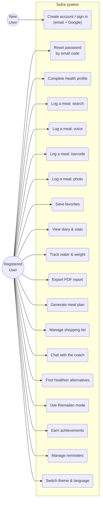
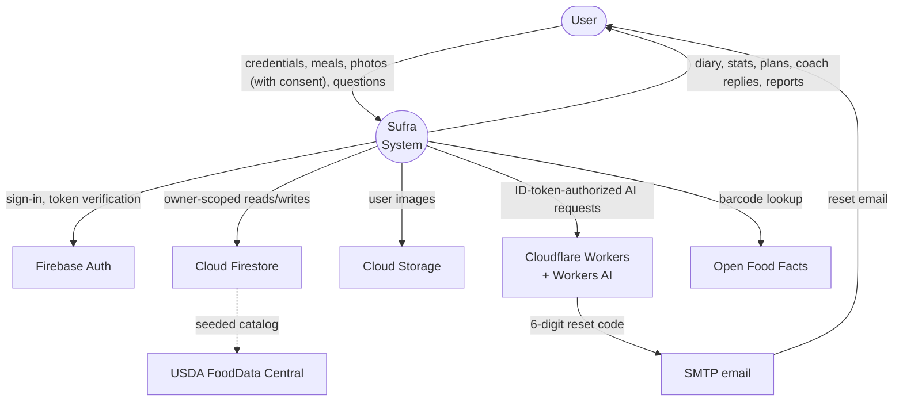
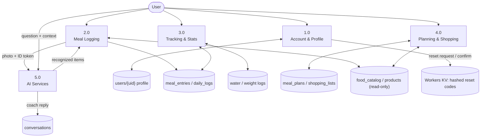
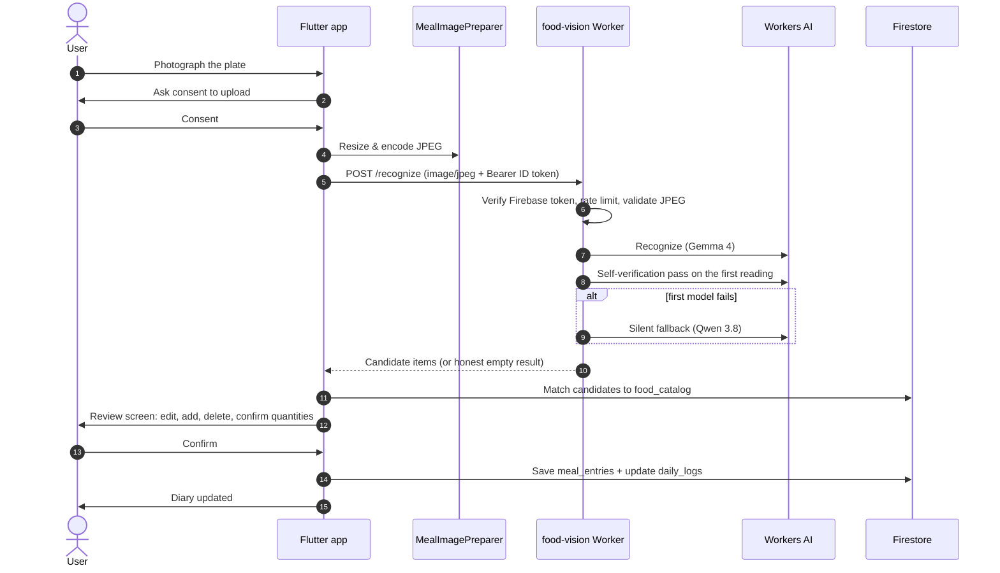
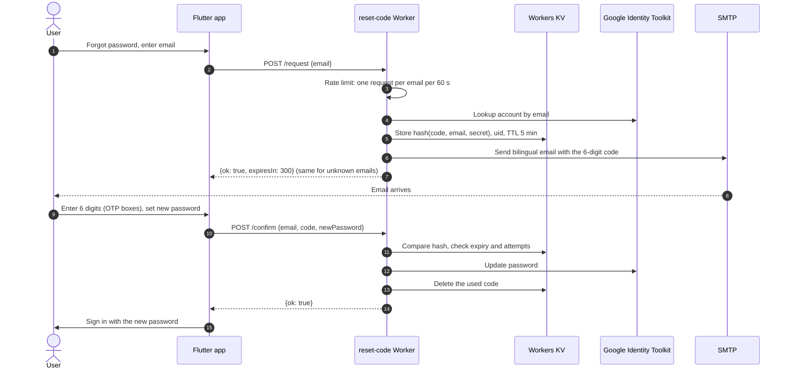
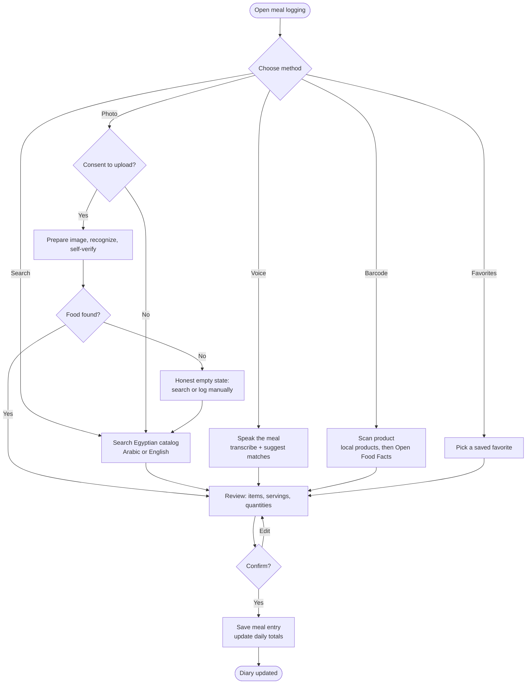
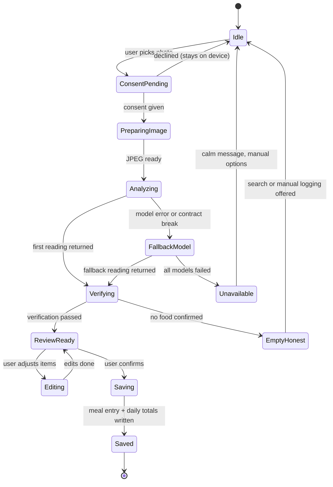

# 09 — Data Flow & System Behavior

**Project:** Sufra (سفرة)
**Group:** HRV | #17 | ONL5_SWD8_G1 | DEPI5
**Track:** Cross-Platform Mobile Development

Every diagram below describes the system as implemented in the repository, not a design aspiration.

---

## 1. Use Case Diagram



**Actor descriptions:**
- **New User:** anyone installing the app; can create an account or continue to sign in.
- **Registered User:** a signed-in account owner; all personal data is scoped to their UID by Firestore rules.
- **Supporting system actors** (not shown for clarity): Firebase Auth (identity), Cloudflare Workers (reset-code, health-coach, food-vision), Workers AI (Gemma 4, Qwen 3.8), Open Food Facts (barcode data), USDA (catalog nutrition), SMTP (reset emails).

---

## 2. Data Flow Diagrams

### DFD Level 0 (context)



### DFD Level 1



---

## 3. Sequence Diagrams

### 3.1 Log a meal by photo (AI recognition)



### 3.2 Coach chat

```mermaid
sequenceDiagram
    autonumber
    actor U as User
    participant App as Flutter app
    participant HC as health-coach Worker
    participant Tool as Catalog calculation tool
    participant G as Workers AI (Gemma 4)
    participant FS as Firestore

    U->>App: Ask a question (Egyptian Arabic or English)
    App->>HC: POST /chat {question, locale, consentVersion, context}
    HC->>HC: Validate input contract + safety preflight
    HC->>Tool: Compute nutrition deterministically (when asked)
    Tool-->>HC: Reviewed calculation (numbers stay server-side)
    HC->>G: Explain using provided context and sources only
    G-->>HC: Draft reply
    HC->>HC: Validate output contract: no numbers, no links,<br/>sourceIds from server list, navigation enum
    alt contract violated
        HC->>G: One corrective retry naming the target language
    end
    HC-->>App: {text, sourceIds, navigation, requiresUserReview}
    App->>U: Reply shown; numbers rendered by the app from the tool
    App->>FS: Append to conversations/messages
```

### 3.3 Barcode product lookup

```mermaid
sequenceDiagram
    autonumber
    actor U as User
    participant App as Flutter app
    participant FS as Firestore (products)
    participant OFF as Open Food Facts

    U->>App: Scan barcode
    App->>FS: Get products/{barcode}
    alt cached
        FS-->>App: Product record
    else miss
        App->>OFF: Lookup by barcode (with contact identification)
        OFF-->>App: Product data
    end
    App->>U: Product page: Nutri-Score, ingredients, allergens
    U->>App: Log a portion / save to favorites
```

### 3.4 Password reset by email code



---

## 4. Activity Diagram — log a meal (all five methods)



---

## 5. State Diagram — photo meal recognition



**Notes:** "EmptyHonest" and "Unavailable" are deliberate end states, not error crashes: the app's principle is that an unknown answer is shown honestly and the user always has a manual path. Nothing is saved before the user confirms.

---

## 6. Class Diagram — core domain model

```mermaid
classDiagram
    class UserProfileModel {
        +String uid
        +String displayName
        +String? email
        +String preferredLanguage
        +String timezone
        +String measurementSystem
        +Map~String,bool~ notificationPreferences
        +bool onboardingCompleted
        +String accountStatus
        +DateTime? createdAt
    }
    class NutritionProfileModel {
        +String profileId
        +String gender
        +DateTime dateOfBirth
        +double heightCm
        +double currentWeightKg
        +double targetWeightKg
        +String activityLevel
        +String nutritionGoal
        +double dailyCalorieTarget
        +double proteinTarget
        +double carbsTarget
        +double fatTarget
        +List~String~ allergies
        +bool isActive
    }
    class MealEntryModel {
        +String mealId
        +String userId
        +String dateKey
        +DateTime consumedAt
        +String mealType
        +String inputMethod
        +String title
        +String? imageUrl
        +List~MealItemModel~ items
        +double totalCalories
        +double? totalProtein
    }
    class MealItemModel {
        +String foodId
        +String foodName
        +double quantity
        +String unit
        +double weightInGrams
        +double calories
        +double? protein
        +String dataSource
        +double? confidence
    }
    class DailyLogModel {
        +String dateKey
        +String timezone
        +double? totalCalories
        +double calorieTarget
        +double proteinTarget
        +double waterIntakeMl
        +int mealCount
        +DateTime? updatedAt
    }
    class WaterLogModel {
        +String waterId
        +double amountMl
        +DateTime consumedAt
        +String dateKey
    }
    class WeightLogModel {
        +String weightId
        +double weightKg
        +DateTime recordedAt
        +String dateKey
        +String? note
    }
    class MealPlanModel {
        +String planId
        +String title
        +DateTime startDate
        +DateTime endDate
        +String status
        +double dailyCalorieTarget
        +List~MealPlanMealModel~ meals
        +String generatedBy
    }
    class MealPlanMealModel {
        +String mealId
        +String title
        +String mealType
        +double calories
        +List~String~ foods
        +List~MealPlanFoodPortion~ foodPortions
        +String? dateKey
    }
    class ShoppingListModel {
        +String listId
        +String title
        +String? planId
        +String status
    }
    class ShoppingListItemModel {
        +String itemId
        +String name
        +double quantity
        +String unit
        +String category
        +bool isPurchased
        +String linkedFoodId (nullable)
        +String productBarcode (nullable)
    }
    class FavoriteModel {
        +String favoriteId
        +String targetId
        +String targetType
        +String title
    }
    class FoodCatalogModel {
        +String foodId
        +String name
        +Map localizedNames
        +String? category
        +String? sourceUrl
        +Map servingSizes
        +Map nutritionPer100g
        +String? source
        +String? verificationStatus
    }
    class ConversationModel {
        +String conversationId
        +String title
        +DateTime? lastMessageAt
    }
    class ChatMessageModel {
        +String messageId
        +String role
        +String content
        +String messageType
        +DateTime? createdAt
    }
    class AchievementModel {
        +String achievementId
        +String achievementType
        +String title
        +double progress
        +double target
        +bool isUnlocked
    }
    class DeviceModel {
        +String deviceId
        +String fcmToken
        +String platform
        +bool isActive
    }
    class AppNotificationModel {
        +String notificationId
        +String title
        +String body
        +String type
        +bool isRead
    }

    UserProfileModel "1" --> "*" NutritionProfileModel
    UserProfileModel "1" --> "*" MealEntryModel
    UserProfileModel "1" --> "*" DailyLogModel
    UserProfileModel "1" --> "*" WaterLogModel
    UserProfileModel "1" --> "*" WeightLogModel
    UserProfileModel "1" --> "*" MealPlanModel
    UserProfileModel "1" --> "*" ShoppingListModel
    UserProfileModel "1" --> "*" FavoriteModel
    UserProfileModel "1" --> "*" AchievementModel
    UserProfileModel "1" --> "*" ConversationModel
    UserProfileModel "1" --> "*" DeviceModel
    UserProfileModel "1" --> "*" AppNotificationModel
    MealEntryModel "1" *-- "*" MealItemModel
    MealPlanModel "1" *-- "*" MealPlanMealModel
    ShoppingListModel "1" *-- "*" ShoppingListItemModel
    ConversationModel "1" *-- "*" ChatMessageModel
    FoodCatalogModel "1" <-- "*" MealItemModel : dataSource
```



Optional fields are marked with `?`, matching the models in `lib/data/models/`. Nullable nutrition fields are meaningful: an absent value is an honest unknown, never a silent zero.
