# 11 — UI/UX Design & Prototyping

**Project:** Sufra (سفرة)
**Group:** HRV | #17 | ONL5_SWD8_G1 | DEPI5
**Track:** Cross-Platform Mobile Development

---

## 1. Design Principles

1. **Arabic-first, not translated.** The interface is designed right-to-left from the first pixel: Egyptian food names, Arabic-Indic numerals where they belong, Arabic display typography. English is a full second citizen, not the source.
2. **Design before code.** The whole app was first designed as a complete interactive HTML design system (`design/Sufra_Design_UI_fast.html`, 31 screens with motion and glass effects), then implemented in Flutter against that reference, so the UI reads as one product instead of assembled widgets.
3. **Honest UX.** Real sourced nutrition or a clear empty state, never an invented number. Consent before a photo leaves the device. Errors mapped to words people actually understand, in their language.
4. **One product, every screen.** Phone, tablet and desktop layouts from the same components, with a proper shell on wide screens instead of a stretched phone layout.
5. **Motion with manners.** Hover and press effects everywhere, and full respect for reduced-motion settings.

---

## 2. Color System

Central tokens in `lib/core/theme/app_colors.dart`. The rule is enforced: no literal colors in screen files, everything references tokens.

| Token | Value | Role |
|---|---|---|
| primaryBlue | `#1565C0` | Brand primary |
| turquoise | `#06B6D4` | Brand secondary, protein macro |
| aiPurple | `#7C3AED` | AI features, fat macro |
| copper | `#FB8C00` | Energy accents, carbs macro |
| success | `#22C55E` | Positive states |
| error | `#EF4444` | Errors |
| darkBackground | `#0A1022` | Dark theme base |
| darkSurface | `#111A33` | Dark theme cards |
| lightBackground | `#F6F8FC` | Light theme base |
| lightSurface | `#FFFFFF` | Light theme cards |

Gradients: `primaryGradient` (blue → turquoise), `copperGradient` (copper → deep orange), glass `cardGradient` (white at 13% → 4% on dark). Light accent shades (cyan, orange, green, purple, pink, gold) support illustrations and achievement art.

---

## 3. Typography

Bundled font families (registered in `pubspec.yaml`, loaded from `assets/fonts/`):

| Family | Typeface | Use |
|---|---|---|
| SufraDisplay | 29LT Azahar Display (black) | Large display headings, Arabic-first |
| SufraBody | 29LT Azahar (demi/black) | Body text |
| SufraHeading | Zain | Section headings |
| SufraCalligraphy / SufraSwash | Aref Ruqaa (+ swashes) | Decorative Arabic calligraphy |
| Fallbacks | Cairo, Tajawal, Reem Kufi | Guaranteed Arabic coverage |

Details that matter: digits stay left-to-right inside Arabic text where they are codes (OTP entry converts Arabic-Indic digits), and Arabic-Indic numerals appear where they belong culturally. `readableDisplayStyle` keeps decorative headings legible at small sizes.

---

## 4. Component Library

From `lib/core/widgets/` (all theme-aware, all with press/hover feedback via `SufraControlFeedback`):

- **Buttons:** GradientButton, IconPillButton, GlassPillButton, SelectableSufraChip
- **Navigation:** FloatingGlassNavBar with an animated orbit, SufraNavigation, and a system back guard (predictable back behavior per platform, double-press to exit on Home)
- **Progress:** CalorieRing (custom painter), MacroTile, SufraProgressBar
- **Signature widgets:** WaterGlass (animated fill), InteractiveFoodBowl (custom painter), MethodCube (logging-method selector), GlassShortcut with a wave press effect
- **States:** SufraStateCard (animated empty/error/loading states that never rely on color alone)
- **Media:** CatalogPhoto with baked-in image credits

---

## 5. Themes, Motion & Accessibility

- **Light and dark themes** through a theme cubit; both verified in golden tests.
- **Motion:** orange hover, blue wavy press, applied app-wide. `flutter_animate` was removed because its pending timers break widget tests; plain animation widgets are used instead. `overlay: true` keeps shadows from clipping.
- **Reduced motion:** respected throughout.
- **Large text:** covered by a dedicated golden test (`reminders_large_text.png`).
- **Language:** every user-facing string runs through localization (`lib/l10n`, arb files, Arabic template).

---

## 6. Responsive Behavior

Verified in automated tests at five sizes, in Arabic and English, dark and light:

| Size | Class | Behavior |
|---|---|---|
| 360 px | Small phone | List layouts replace grids below 380 px |
| 390 px | Phone | Reference phone layout |
| 800×1280 | Tablet | Proper shell, no stretched phone layout |
| 1280×800 | Small desktop | Shell with navigation adapted |
| 1440×900 | Desktop | Full-width layouts |

---

## 7. Wireframes & Mockups

The authoritative prototype is the interactive design system itself: **`design/Sufra_Design_UI_fast.html`** (31 screens, motion, glass components, both themes).

Below are the implemented screens, rendered by the app's own test suite (not mockups). More renders live in `docs/readme/screens/` and 150+ golden images under `test/**/goldens/`.

| | | |
|---|---|---|
| 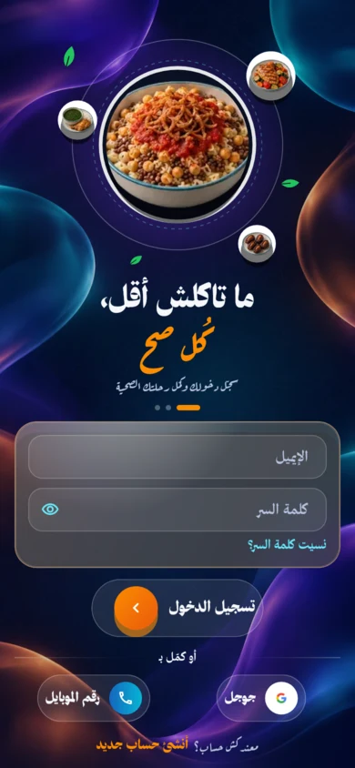 | 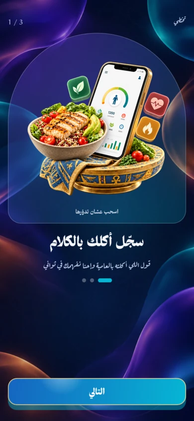 | 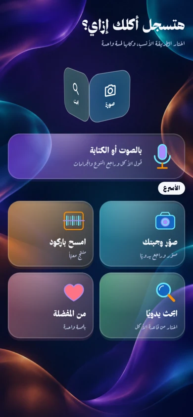 |
| Sign in: email, Google | Log a meal by saying it | Five ways to log |
| 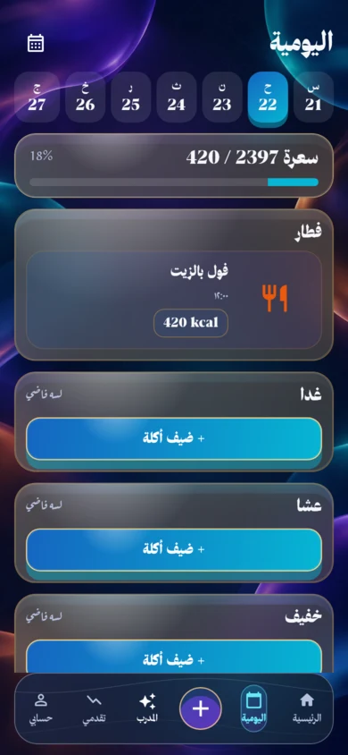 | 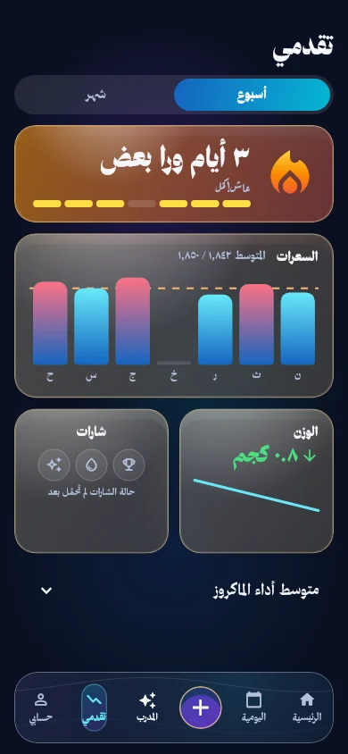 | 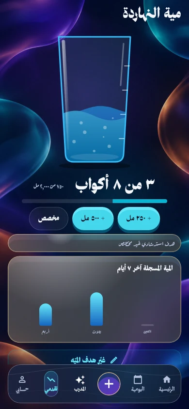 |
| Daily diary | Streaks and weekly stats | Water tracking |
| 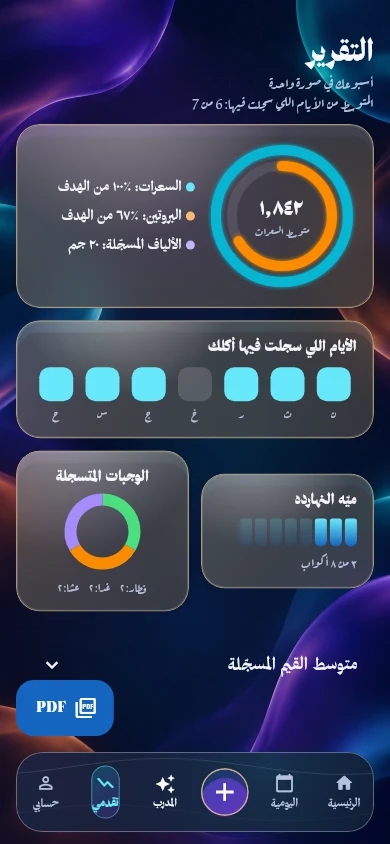 | 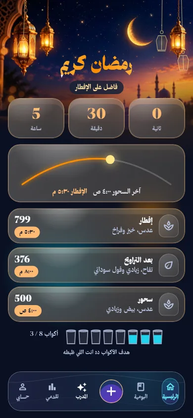 | 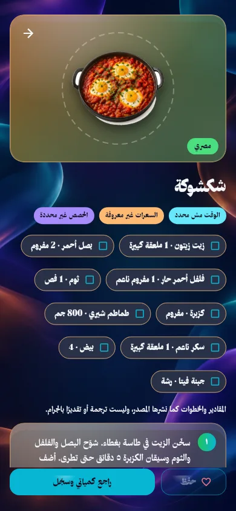 |
| Reports with PDF export | Ramadan mode | Real dishes, real numbers |
| 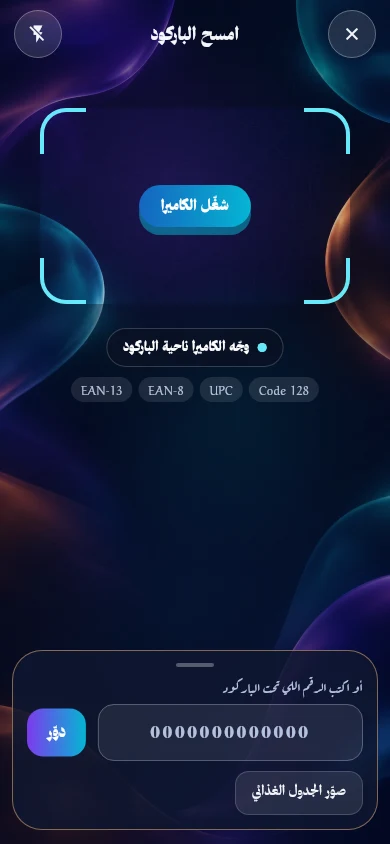 | 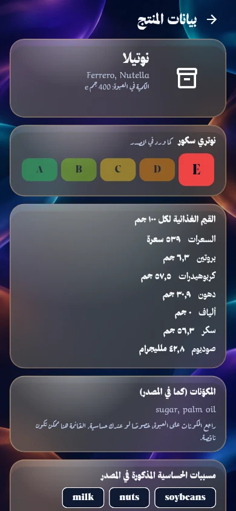 | 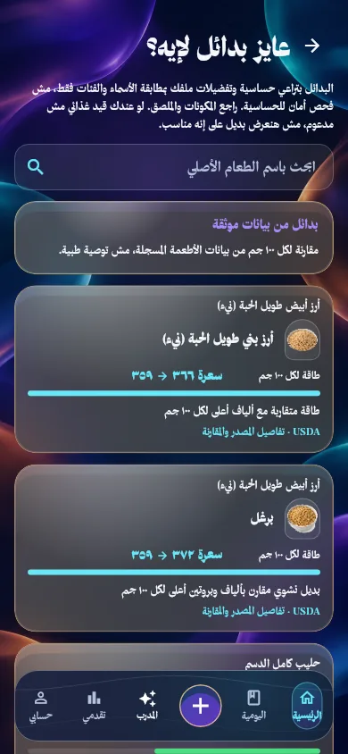 |
| Point at any barcode | Nutri-Score, ingredients, allergens | Healthier swaps |
| 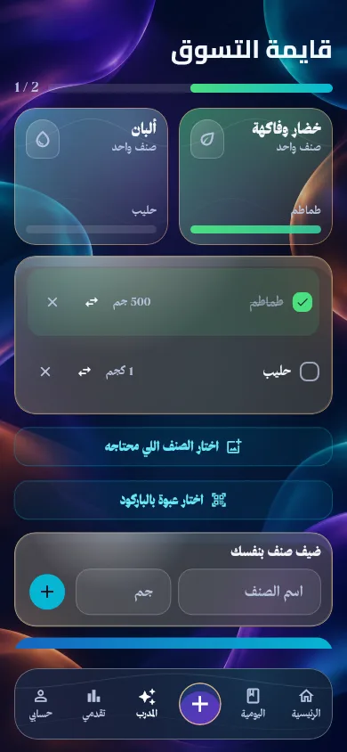 | 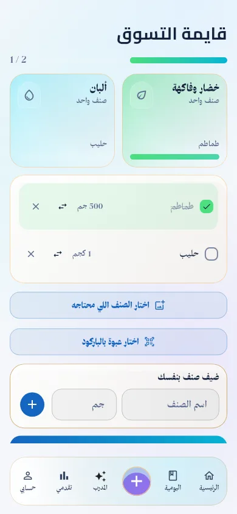 | |
| Shopping list, dark | Shopping list, light | |

The complete numbered screen list (31 screens) and each member's ownership are documented in `03-task-assignment-and-roles.md`.
